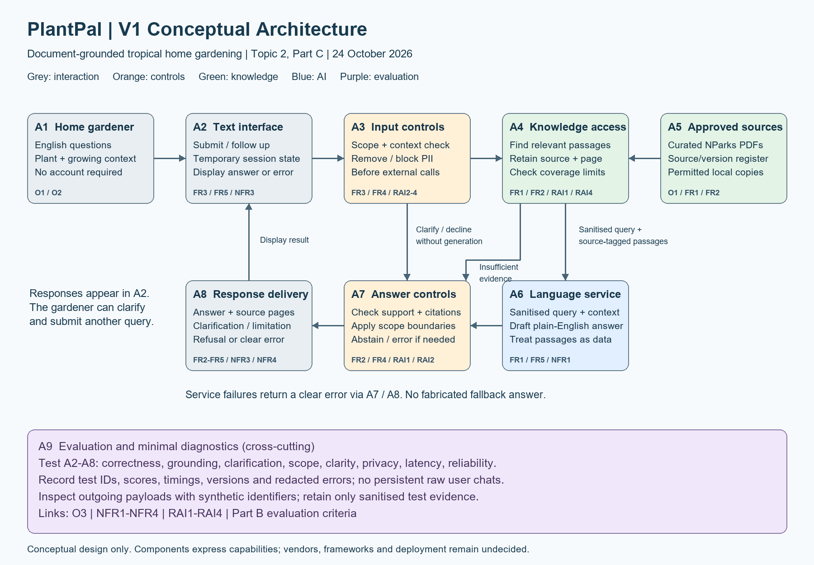

# PlantPal - V1 Architecture Decisions and Traceability

**Version:** 1.0

**Date:** 24 October 2026

**Status:** Topic 2, Part C conceptual design. No components have been implemented or evaluated. Acceptance targets remain those in Parts A and B.

Inputs: [requirements](week2_requirements.md) and [evaluation criteria](week2_evaluation_criteria.md).

Diagram: [PNG](week2_architecture_v1.png) | [editable Draw.io source](week2_architecture_v1.drawio).

## Starting Point and Architecture Needs

The simplest starting point is **User -> Application Interface -> AI Capability -> Response**. A language model alone cannot demonstrate that a gardening answer came from an approved NParks document or that a cited page supports its claims. PlantPal therefore adds knowledge access, provenance, explicit controls, and evaluation capabilities justified by the requirements below. These are logical responsibilities and can initially reside within one small application; each box does not require a separate deployed service.

| Requirement / constraint | What the simple flow lacks | Architecture response |
|---|---|---|
| FR1, FR2, NFR2, RAI1 | Approved gardening information and page-level provenance | A4 knowledge access and A5 curated sources; source tags retained through A6 and A7. |
| FR3, FR4, RAI2, RAI4 | Decisions about missing context, coverage and excluded requests | A3 input controls, A4 coverage checks, and A7 answer controls. |
| RAI3 | Protection before information reaches external services | A3 removal/blocking of identifiers before external processing; temporary rather than persistent session context. |
| FR5, NFR4 | Beginner-readable, qualified explanations | A6 language service and A8 response delivery. |
| NFR1, NFR3 | Measurable latency and explicit failure behaviour | A bounded interaction path, error routing through A7/A8, and A9 diagnostics. |
| O3, NFR1-NFR4, RAI1-RAI4 | Reproducible evidence that requirements are met | A9 test harness, reviewed cases, timings, and sanitised result records. |

## Component Responsibilities and Information Flow

| ID | Architecture element | Responsibility |
|---|---|---|
| A1 | Home gardener | Supplies an English question and relevant plant/growing context. |
| A2 | Text interface and temporary session state | Receives questions, displays results, and supports follow-up clarification. Raw session input is transient and is not logged or forwarded externally before A3 checks. Clear session state at session end. |
| A3 | Input controls | Check scope and essential context; remove or block names, exact addresses, phone numbers, and email addresses before any external model or retrieval API call. Use local checks first; an external classifier must not receive unfiltered input. |
| A4 | Knowledge access | Select relevant passages from the approved collection, keep document/title/URL/page identifiers, and identify coverage gaps. The retrieval method remains undecided. |
| A5 | Approved sources and register | Hold permitted local NParks material and source metadata. Admission includes checking usage terms, extracting readable text, preserving page boundaries, and reviewing coverage. Detailed pipeline tooling is deferred. |
| A6 | Language model service | Receive sanitised context and source-tagged passages; draft a concise explanation with citations. Retrieved material is treated as evidence, not as instructions that override application rules. |
| A7 | Answer controls | Check references, scope, and evidence support. Select a supported answer, clarification, refusal, abstention, or error outcome. Semantic support checks are fallible and require evaluation; the box does not promise perfect verification. |
| A8 | Response delivery | Format the selected outcome for display in A2, keeping citations, limitations, and error messages visible. |
| A9 | Evaluation and minimal diagnostics | Test A2-A8 against Part B. Store test IDs, scores, timings, versions, and redacted error categories. Inspect synthetic test payloads for privacy; retain sanitised evidence rather than raw user conversations. |

### Normal and Alternate Paths

1. **Supported question:** A1 -> A2 -> A3 -> A4, using A5 -> A6 -> A7 -> A8 -> A2. A4 supplies relevant passages with document and page identifiers; A6 drafts the answer; A7 checks it before delivery.
2. **Missing context or excluded request:** A3 -> A7 -> A8 -> A2. Use a clarification or refusal without unnecessary answer generation. The user may provide new context through A2; it passes A3 again.
3. **Insufficient source evidence:** A4 -> A7 -> A8 -> A2. State the evidence limitation instead of substituting unsupported model knowledge. If the evidence problem is found after generation, A7 withholds the draft and delivers an abstention.
4. **Service failure:** An error in knowledge access or generation is handled by the application and routed through A7/A8 as a clear error message. No fabricated answer is used as a fallback. Timeouts and any retry budget must be bounded and included in latency measurements.
5. **Evaluation:** A9 exercises the interface, observes each relevant control boundary, and records sanitised results. It is a cross-cutting development capability rather than an additional user-facing chat stage.

## Architecture Design Record (ADR)

| Decision | Requirement/Constraint | Alternatives Considered | Selected Option | Trade-off Accepted |
|---|---|---|---|---|
| ADR1 - Provide explicit knowledge access | FR1, FR2, NFR2, RAI1; a small approved document collection | Base model only; keyword-search interface only; retrieval-supported generation; entire corpus in every prompt | A4/A5 provide relevant, source-tagged passages to A6. Keep keyword search as an evaluation baseline. Research motivation: R1 and R3. | Adds retrieval and provenance work and can miss relevant evidence. It provides a route to source-grounded explanations, but its benefit over search must be measured. |
| ADR2 - Preserve citations and check answers before release | FR2, FR4, RAI1, RAI2 | Ask the model to cite sources without checking; validate only URL/page existence; check identifiers and claim support with an abstention path | A7 checks valid source/page references and evidence support; A8 displays references and limitations. Pair automated checks with offline manual evaluation. Research motivation: R2. | Validation costs time and may reject a useful answer. Semantic checks can still fail; real citations do not automatically prove support. |
| ADR3 - Separate input and output controls | FR3, FR4, RAI2, RAI4 | One instruction in a prompt; input controls only; controls before and after generation | A3 checks context and scope before generation, while A7 checks the proposed response. A4 identifies unsupported knowledge coverage. | Extra logic and possible false refusals, but clearer responsibility and test points. This is a requirement-driven design choice, not a demonstrated safety guarantee. |
| ADR4 - Minimise personal information and persistence | RAI3; no account required; public student repository | Persistent user profiles; raw prompt logging; temporary session context with removal/blocking before external use | A2 holds transient session context, A3 checks all external-bound context, and A9 stores only sanitised test evidence and minimal diagnostics. | Less personalisation and harder debugging. Identifier detection may miss unusual forms and must be tested; synthetic-case success does not prove universal privacy protection. |
| ADR5 - Bound the response path | NFR1, NFR3; single-user semester prototype | Multiple agents/tools and repeated model calls; full-document prompts; a single answer-generation path with selective context and bounded failure handling | A4 selects relevant context, A6 drafts an answer once on the normal path, and A7 either accepts or returns an appropriate limitation/error. Defer open-ended regeneration loops. Research motivation for selective context: R3. | Less opportunity for iterative answer repair. Better control of latency is plausible but remains unmeasured; model selection and validation costs may require refinement. |
| ADR6 - Make evaluation a separate, observable capability | O3, NFR1-NFR4, RAI1-RAI4 | Informal demonstration only; production chat logging; defined synthetic/curated tests with minimal diagnostics | A9 measures the Part B criteria, including privacy payload inspection, controlled failures, citation support, and comparison with search. | Requires reference annotations and manual review time, but creates traceable evidence without collecting real user histories. |

## Research Basis and Limits

| Reference | Relevant research finding | How it informs PlantPal | Limit of the inference |
|---|---|---|---|
| R1 - Lewis et al. (2020) | Investigates combining retrieval from external memory with language generation for knowledge-intensive tasks. | Supports considering A4/A5 alongside A6 rather than relying only on model parameters. | PlantPal is not reproducing the paper's training architecture or benchmark results. Gardening performance must be evaluated locally. |
| R2 - Gao et al. (2023) | Studies generated answers with citations and evaluates citation quality; the reported systems still have substantial citation-support limitations. | Supports retaining provenance and checking support separately from merely detecting a citation in A7/A9. | A citation checker is not a guarantee of truth, and PlantPal's targets are project choices rather than results from this paper. |
| R3 - Liu et al. (2024) | Finds that performance in studied tasks can depend on where relevant information appears in a long context. | Motivates selective context and testing multi-passage answers instead of assuming that sending every document is sufficient. | This does not establish that retrieval is always superior, or that every current model has identical limitations. Context selection remains a design hypothesis to test. |

The papers motivate architectural capabilities. They do not prescribe PlantPal's exact model, framework, database, thresholds, or control implementation. Privacy and scope controls above are derived primarily from the agreed requirements.

## Initial Requirements Traceability Matrix

The Requirement Type column includes the exact requirement IDs so each row can be traced to Part A. Criterion names correspond to Part B; Later Evidence describes planned evidence, not existing results.

| Objective ID | Requirement Type | Evaluation Criterion | Architecture Element | Later Evidence |
|---|---|---|---|---|
| O2, O3 | Functional FR1; Non-functional NFR2 | Answer correctness | A4 knowledge access, A5 sources, A6 language service, A7 answer controls | Scored answers for 40 questions, source-page annotations, topic-level results; target at least 34/40 correct. |
| O1, O2, O3 | Functional FR2; Responsible AI RAI1 | Citation completeness and source support | A4/A5 provenance, A6 cited drafts, A7 validation, A8 delivery | Claim-level audit with reference completeness and passage support; targets 100% coverage and >=95% support. |
| O2, O3 | Functional FR4; Responsible AI RAI1 | Abstention when evidence is insufficient | A4 evidence/coverage check, A7 abstention, A8 delivery | Reviewed 20 unsupported cases; target at least 19/20 appropriate abstentions. |
| O1, O2, O3 | Functional FR3; Responsible AI RAI4 | Clarification of missing context | A2 follow-up context, A3 context check, A7/A8 clarification | Ten annotated ambiguous cases and response records; target at least 9/10 appropriate clarifications. |
| O1, O2, O3 | Functional FR4; Responsible AI RAI4 | Disclosure of species or climate coverage limits | A4/A5 coverage register, A7 limitation decision, A8 display | Ten designated coverage cases within the unsupported set; target 10/10 disclosures. |
| O1, O2, O3 | Functional FR4; Responsible AI RAI2 | Safe handling of out-of-scope requests | A3 scope check, A7 output check, A8 refusal | Twenty reviewed safety/scope responses; at least 19/20 full passes and zero excluded actionable instructions or safety guarantees. |
| O2, O3 | Functional FR5; Non-functional NFR4 | Response clarity | A6 explanation, A8 presentation | Three-point rubric scores for 40 answers; target at least 36/40 scoring 3/3. |
| O2, O3 | Non-functional NFR1 | Complete-response latency | A2-A8 full interaction path; A9 timing | Forty-question sequential workload, environment details and failure counts; median <=10 seconds and p95 <=20 seconds. |
| O2, O3 | Non-functional NFR3 | Operational completion and controlled error handling | Application orchestration across A2-A8; A9 fault tests | Normal-workload records showing at least 89/90 completions, plus 5/5 controlled service failures handled correctly. |
| O2, O3 | Responsible AI RAI3 | Privacy and data minimisation | A2 temporary state, A3 external-bound checks, A9 sanitised diagnostics | Twenty synthetic privacy scenarios, outgoing-payload and log inspection; zero identifier transmissions, persistence, or unnecessary requests. |

## Final V1 Review

- Each component is justified by a requirement or evaluation need in the tables above.
- Knowledge access, source/page tracking, input/output controls, failure handling, and evaluation points are present.
- Use the simplest implementation of each capability first. The diagram does not mandate microservices, a vector database, a vendor, a particular language model, or a guardrail framework.
- A dedicated persistent memory store, autonomous tools, live weather service, image analysis, and automated watering are omitted because V1 requirements do not justify them.
- A7's semantic checking method and A3's identifier detection require later implementation experiments. Their presence in the diagram does not demonstrate that acceptance thresholds are met.
- Source rights, extraction quality, supported plant coverage, API choice, runtime cost, and latency feasibility remain to be confirmed before implementation.

## Part C Reflection

The most important trade-off is ADR1: adding document knowledge access rather than relying on the language model alone. FR1, FR2, NFR2, and RAI1 require answers to be connected to approved gardening information and verifiable sources. A4/A5 make that connection possible, but introduce document preparation, retrieval errors, and additional response time. Selective context also risks omitting a passage needed for a complete answer. I accept this complexity because source-grounded explanations are central to PlantPal's purpose, while retaining keyword search as a baseline and testing correctness, citation support, and latency to determine whether the approach is useful.

## References

- **R1:** Lewis, P., et al. (2020). *Retrieval-Augmented Generation for Knowledge-Intensive NLP Tasks*. NeurIPS 33. https://arxiv.org/abs/2005.11401
- **R2:** Gao, T., Yen, H., Yu, J., and Chen, D. (2023). *Enabling Large Language Models to Generate Text with Citations*. EMNLP, pp. 6465-6488. https://aclanthology.org/2023.emnlp-main.398/
- **R3:** Liu, N. F., Lin, K., Hewitt, J., Paranjape, A., Bevilacqua, M., Petroni, F., and Liang, P. (2024). *Lost in the Middle: How Language Models Use Long Contexts*. Transactions of the Association for Computational Linguistics, 12, 157-173. https://aclanthology.org/2024.tacl-1.9/

Research source pages checked on 24 October 2026. Gardening source documents and their URLs are listed in [Part A](week2_requirements.md).
